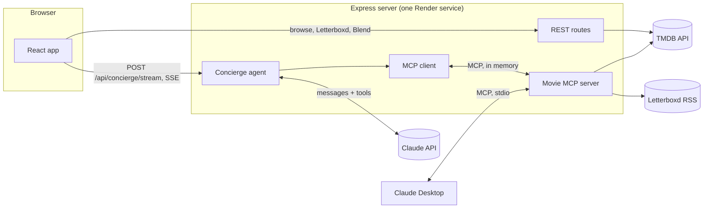

# Marquee

[](https://github.com/mightym215/marquee/actions/workflows/ci.yml)

**An AI movie concierge.** Tell it what you're in the mood for, like *"something like Interstellar, but funny,"* and it finds real movies, explains why each one fits, and shows every step it took to get there. Connect your Letterboxd and it learns your taste. Add a friend's and it plans movie night for both of you.

## Why I built this

I love movies. They're how I escape. Even if it's only for 30 minutes, I get to live alongside the characters for a while, and honestly that feels like an honor. I also love the other side of watching: catching the details a director put there on purpose and figuring out why.

Marquee is the movie friend I always wanted. It knows what I've loved on Letterboxd, and when I say "something like Interstellar, but funny," it actually gets it.

## What it does

- **Ask for anything.** A Claude agent turns moods, eras, lengths, languages, and "like X" requests into real TMDB searches, then picks 3 to 6 movies with a reason for each.
- **Watch it think.** Each step streams to the page as it happens: *Searching for "Interstellar" → Browsing Comedy + Science Fiction → Choosing the best picks.* A "How I found these" panel shows every tool call, its arguments, and its timing.
- **Letterboxd sync.** Your diary fills in Watched, your hearts become Favorites, your star ratings show on every poster, and the concierge builds on your highest rated films.
- **Blend: movie night for two.** Two Letterboxd accounts in, out comes a taste match score, the films you both loved, and picks neither of you has seen, each with the favorites that led to it.
- **"Because you gave Arrival ★★★★★."** A home page row built from your latest top rated film.
- **Everything a movie app should have.** Now playing, trending, search, sorting, details with cast photos, trailers, where to stream, and links to Letterboxd, IMDb, and TMDB.

## Architecture



The repo has three packages:

| Package | What it is |
| --- | --- |
| `packages/tmdb-mcp` | The movie MCP server: a typed TMDB client, the Letterboxd reader, Blend, and 8 tools. Runs over stdio for Claude Desktop or in process for the app. |
| `apps/api` | Express API, the concierge agent loop, server-sent events streaming, rate limits, and the eval harness. |
| `apps/web` | The React app. Plain CSS, no UI framework. |

## How the concierge works

1. The API asks the MCP server for its tools and hands them to Claude, plus one app tool, `present_picks`.
2. Claude plans: search a title, pull recommendations, read a Letterboxd diary, or translate a mood into `discover_movies` filters.
3. Each call goes through a real MCP client. Results come back two ways: compact JSON for the model (fewer tokens) and full structured data for the app (posters, ids).
4. Claude calls `present_picks` with movie ids and reasons. The server only trusts ids it saw in tool results. Others are looked up, flagged as not grounded, and dropped if they don't exist.
5. Every step streams to the browser as a server-sent event, so the UI updates live.

**Guardrails:** picks must come from tool results, bad tool calls return errors the model can fix (a wrong genre returns the list of valid ones), each question is capped at 6 model calls, and the loop stops if the browser disconnects.

**Cost controls:** the concierge is the only part that spends money (Claude API). The public demo allows 30 questions a day for the whole site, 8 per visitor per day, and 4 per visitor per minute, all set by environment variables. When a limit is hit, browsing, Letterboxd, and Blend keep working.

## Evaluation

The concierge is graded, not just demoed. `npm run eval` runs 21 real requests through the live agent and checks every pick against TMDB data, not against what the model claims:

| Check | Example request |
| --- | --- |
| Grounded (no movies from memory, no invented ids) | every case |
| Runtime limits | "A cozy movie under 2 hours" |
| Years | "A 90s classic I probably missed" |
| Genres | "A romantic comedy from the 2000s" |
| Language | "The best Korean thrillers" |
| Minimum rating | "Highly rated crime movies from the 70s" |
| Skips what you've watched | "More space movies like the ones I've watched" |
| Declines off topic requests | "What's the capital of France?" |

The report lands in `apps/api/eval-reports/latest.md` with case pass rate, pick accuracy, grounding rate, average steps, p95 latency, tokens, and estimated cost per request. The scorer and runner have their own tests, which run offline in CI.

### Comparing models

`npm run eval:compare` runs the same cases against two or more models, several trials each, and reports consistency rather than a single score: which cases a model passes every time, which it passes only sometimes, and which check breaks when it fails.

The first run of it points Salesforce's open [xLAM-2](https://github.com/SalesforceAIResearch/xLAM) action model at the suite and compares it to the hosted baseline. Short version: tool selection, multi-step state and grounding all held, but the 8B cleared the minimum pick count once in 60 attempts, and the only case it passed in every trial was the one where the correct answer is to return nothing. Structured output against a nested schema is the wall, and it is intermittent rather than absent, which is the harder kind.

Getting to a number that meant anything took more work than producing one. A context default ran the model two thirds on CPU at 0.56 tok/s. A scorer credited constraints it never evaluated. And **two of the three serving setups tried destroy this model's tool calls before the agent sees them, in opposite ways**: Ollama ships no parser for its output format so correct calls arrive silently as prose, and llama.cpp's grammar rejects them outright, 500ing 59 of 63 agent turns over a trailing bracket. Under its own chat template the model emits correct tool calls that the runtime then throws away. All of it is written up with the evidence.

**[Full results and limitations](./apps/api/eval-reports/RESULTS.md)** · [raw report](./apps/api/eval-reports/comparison.md) · [how to run it](./apps/api/src/eval/README.md)

### Running the agent on another model

The agent never constructs an Anthropic client. It takes one in, typed as the only method it actually calls:

```ts
export interface MessagesClient {
  messages: {
    create(params: Anthropic.MessageCreateParamsNonStreaming): Promise<Anthropic.Message>;
  };
}
```

Anything that satisfies that can drive the concierge, so the comparison runs **the real agent loop and the real MCP tools** against every model rather than a simplified reimplementation of them. A benchmark that re-creates the agent in order to test it is measuring the re-creation.

`providers/openaiCompat.ts` implements that interface against any OpenAI-compatible endpoint (Ollama, vLLM, llama.cpp server). It translates in both directions:

| Anthropic shape | OpenAI shape |
| --- | --- |
| `system` as a top level parameter | first message, `role: "system"` |
| `tools[].input_schema` | `tools[].function.parameters` |
| `tool_use` content block | `tool_calls[]` on the assistant message |
| `tool_result` blocks inside one user message | one message each, `role: "tool"` |
| `stop_reason: "tool_use"` | `finish_reason: "tool_calls"` |
| `usage.input_tokens` | `usage.prompt_tokens` |

**It is deliberately tolerant, and counts instead of crashing.** A small model that emits arguments which are not valid JSON gets an empty object, so the agent's own validation rejects the call and hands the model an error it can act on. That is the behavior worth measuring. A tool call with no id gets one invented, so the transcript stays well formed and tool results can still be matched. Both are counted.

**It also recovers tool calls the server failed to parse.** Some models, xLAM included, return tool calls as their own JSON in the message content rather than in `tool_calls`. Lifting those out is the serving stack's job (vLLM's `--tool-call-parser xlam`, llama.cpp's `--jinja`), and a runtime without a parser for that model silently turns correct tool calls into prose. The adapter recovers them, but only when the server returned no tool calls of its own, the whole content parses as JSON, and **every** entry names a tool the request actually declared, so it can never invent a call the model did not make. Recoveries are counted and written into the report, because needing one is a fact about the serving stack that changes how the numbers should be read.

Adding a model is one entry in `BACKENDS` in [`models.ts`](./apps/api/src/eval/models.ts).

## MCP tools

| Tool | What it does |
| --- | --- |
| `search_movies` | Find movies by title or keywords |
| `discover_movies` | Filter by genres, years, rating, runtime, language, and sort order |
| `get_movie_details` | Runtime, director, cast, tagline, trailer, where to watch |
| `get_recommendations` | Movies fans of a given movie also like |
| `get_trending` | What's trending today or this week |
| `list_genres` | Every genre TMDB supports |
| `get_letterboxd_diary` | A member's recent diary: films, star ratings, likes, rewatches, matched to TMDB |
| `blend_letterboxd` | Taste match and shared picks for two Letterboxd members |

All tools are read only and declare output schemas.

## How Blend works

1. **Taste vectors.** For each person, every logged film adds weight to its genres: 5 stars counts +3, 3 stars +1, 1 star −1, and a heart adds 1.
2. **Match percent.** Cosine similarity of the two vectors, ignoring dislikes.
3. **Picks.** Each person's top 3 loved films become seeds. TMDB recommendations for all six are pooled, anything either person has logged is removed, and a movie scores higher when seeds from *both* people point to it.

## Letterboxd sync

Letterboxd has no open API, but every public profile publishes an RSS feed at `letterboxd.com/<username>/rss/` with each logged film, the rating, likes, rewatches, and the film's TMDB id. Marquee reads it server side (cached for 10 minutes and rate limited), matches each film to TMDB by id (or by title and year as a fallback), and merges it into your library in the browser. Nothing is written to Letterboxd. The feed covers recent activity, about the last 50 entries. Marquee isn't affiliated with Letterboxd.

## Run it locally

You need Node 22 or newer.

```bash
npm install
cp .env.example .env   # add TMDB_API_KEY, and ANTHROPIC_API_KEY for the concierge
npm run build
npm start              # http://localhost:8787
```

- **No keys yet?** `MARQUEE_DEMO=1 npm start` runs the whole app on sample data, including sample Letterboxd diaries for any username.
- **Live reload:** `npm run dev`, then open http://localhost:5173.
- **Tests:** `npm test`. 79 tests cover the TMDB client, the Letterboxd parser, Blend, every MCP tool over a real MCP connection, the agent loop and streaming, the API, the rate limiter, the eval scorer, and the OpenAI-compatible adapter. They run on sample data with no keys or network.
- **Eval:** `npm run eval` (needs both keys), or `npm run eval -- 5` for a quick 5 case run.

## Use the MCP server in Claude Desktop

After `npm run build`, add this to your Claude Desktop config (Settings, Developer, Edit Config) and restart Claude:

```json
{
  "mcpServers": {
    "marquee": {
      "command": "node",
      "args": ["/absolute/path/to/marquee/packages/tmdb-mcp/dist/stdio.js"],
      "env": { "TMDB_API_KEY": "your key" }
    }
  }
}
```

Then ask Claude things like "blend my Letterboxd with my friend's and pick something for tonight."

## Deploy on Render

1. Push this repo to GitHub.
2. In Render, choose **New, Blueprint** and pick the repo. `render.yaml` sets up one free web service.
3. Add `TMDB_API_KEY` and `ANTHROPIC_API_KEY` in the service's environment settings.

## Tech

TypeScript, React 19, Vite, Express 5, Model Context Protocol SDK, Anthropic SDK, server-sent events, Zod, Vitest, GitHub Actions, Render.

Movie data from [TMDB](https://www.themoviedb.org). This product uses the TMDB API but is not endorsed or certified by TMDB.

## License

MIT © Michael Mensah
